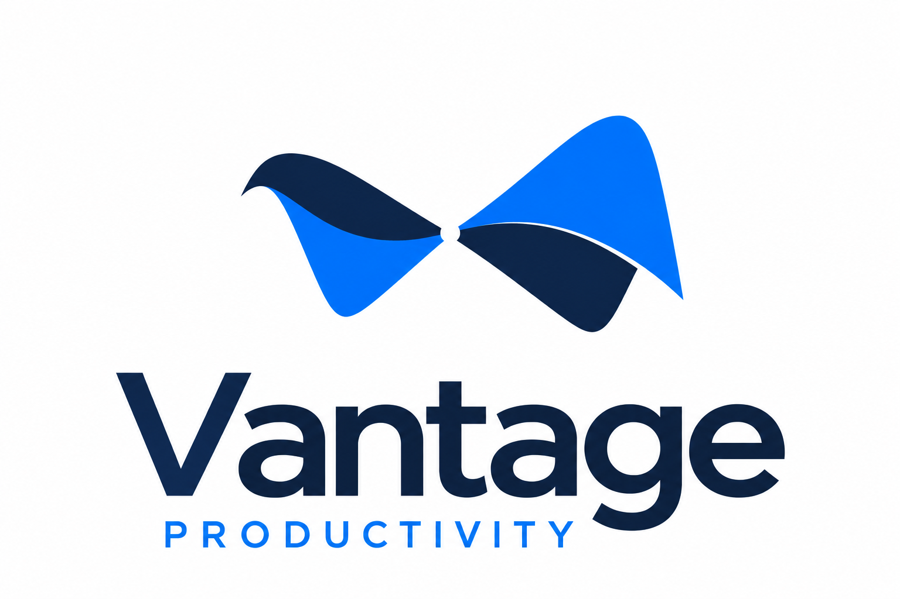

# Vantage Productivity

<p align="center"></p>

**Write the document. Calculate the numbers. Present the decision. Keep the work together.**

Vantage Productivity is an open-source Windows desktop suite with six editors for **DOCX, XLSX, PPTX, PDF, Markdown and HTML**, plus local calendar, contacts, records, search and recovery tools. Use one workspace to move from a written proposal to a spreadsheet, a slide deck and supporting notes, while keeping ordinary document editing on your computer.

**Current download: 0.15.0-brand.1, an unsigned Windows x64 development preview.** It is for evaluation and feedback. This branding preview is based on the published 0.15.0-dev.1 feature baseline, with the saddle identity, shared interface palette and a portable-updater guard. Full Office compatibility and production readiness have not been established.

[Download the Windows preview](https://github.com/Adilson09/vantage-productivity/releases/tag/v0.15.0-brand.1) · [Share your experience](https://github.com/Adilson09/vantage-productivity/issues/new?template=feedback.yml) · [Report a bug](https://github.com/Adilson09/vantage-productivity/issues/new?template=bug_report.yml) · [Request a feature](https://github.com/Adilson09/vantage-productivity/issues/new?template=feature_request.yml)

## Our visual identity


The saddle-point logo combines **electric blue (#0072FC)** and **deep navy (#0D264A)**. Cool white surfaces keep the work readable; light-theme controls use **action blue (#0064D9)** for stronger text contrast. Dark mode uses navy surfaces with pale-blue controls. Read the [complete brand palette and contrast pairs](docs/BRAND.md).

## What you can work on

| Tool              | What it provides                                                                                                                                                                                                                                      |
| ----------------- | ----------------------------------------------------------------------------------------------------------------------------------------------------------------------------------------------------------------------------------------------------- |
| **Documents**     | A DOCX editing workspace for written documents. Open and revise document content, then save a document copy.                                                                                                                                          |
| **Spreadsheets**  | An XLSX editing workspace with native formula calculation, selected pivot refresh paths and XLSM resource preservation. Macro resources can be retained; VBA and XLM do not execute.                                                                  |
| **Presentations** | A PPTX editing workspace for slide content and layout, with slideshow playback and PDF export.                                                                                                                                                        |
| **PDF**           | A PDF workspace for reading, highlighting, underlining, strikeout and sticky-note threads, alongside separate structural inspection using PDF parsing and bundled qpdf. Structural checks do not certify visual fidelity or PDF standards compliance. |
| **Markdown**      | A Markdown editing workspace with original-source retention for unchanged documents and text draft journaling for named and unnamed files.                                                                                                            |
| **HTML**          | An HTML editing workspace with visual/source editing and export to PDF, DOCX and standalone HTML.                                                                                                                                                     |

These are implemented modules, with different levels of testing. End-to-end create, edit, save, reopen, export and failure acceptance is still incomplete across all six editors. Evaluate representative copies of your documents before relying on the preview for important work.

## More than six file tabs

The home workspace and **Tools and privacy** provide these local tools:

- **Calendar and contacts:** create, import and export iCalendar files; expand bounded recurring events using embedded time zones; import and export vCard contacts. Live invitations, delegation and complete provider synchronization remain unfinished.
- **Local records:** store typed records in SQLite, enter records in the desktop tools and run bounded read-only queries. Saved form definitions, HTML reports and CSV output are available through the productivity tools. This is not an Access-compatible database or a complete visual form/report designer.
- **Search:** index local file content with SQLite FTS5 and search the resulting local index.
- **Document inspection:** examine supported document structure in a separate bounded process. PDF checks include actual object/page-tree parsing and qpdf structural checks.
- **Saved versions:** keep bounded document history, see retention warnings and restore a separate recovered copy. Storage limits can prune or skip history; it is not a complete backup.
- **Draft recovery:** journal Markdown text every 15 seconds and on blur, then recover a separate copy or discard it. Pasted assets are not bundled. Complete unsaved-state recovery for the other five editors remains unfinished.
- **Optional encrypted history:** protect new history and draft payloads with an OS-protected key. Existing plaintext history is not silently encrypted or migrated.

For automation, the **`vantage` command line**, MCP integration and productivity commands expose document and local-data operations. Cooperative checkout commands coordinate participating writers and keep conflict copies; they do not provide real-time coauthoring or enforce every editor save.

## Try the Windows preview

1. Open the [0.15.0-brand.1 release](https://github.com/Adilson09/vantage-productivity/releases/tag/v0.15.0-brand.1).
2. Download **`Vantage-Productivity-0.15.0-brand.1-win-x64.zip`** and its matching **`.sha256`** file.
3. Extract the **entire ZIP** into a writable folder. Keep the application, resources and helper programs together.
4. Run **`Start-Vantage-Preview.cmd`** from that folder. It creates separate preview profile and authentication storage under `%LOCALAPPDATA%`.
5. Open a copy of a representative file, make a small change, save it and reopen it. Tell us how the result compares with what you expected.

The downloadable application is **Windows x64**. Vantage Mail requires Microsoft Edge WebView2 Runtime. The application is unsigned; independent clean-machine, installer, update, uninstall and signing acceptance remain open. Linux, macOS and Windows ARM64 are not delivered or validated by this release.

To check the downloaded archive in PowerShell:

```powershell
Get-FileHash .\Vantage-Productivity-0.15.0-brand.1-win-x64.zip -Algorithm SHA256
Get-Content .\Vantage-Productivity-0.15.0-brand.1-win-x64.zip.sha256
```

The hash values must match. The release also provides a separately packaged source archive.

## Local work, optional connected features

**Local mode starts enabled and remote features start disabled.** The application policy controls Electron web requests and main-process `fetch`. Remote access through those paths requires enabling the relevant feature and approving its HTTPS origin. Loopback services are permitted. Native companions, external commands and raw sockets need separate controls; this is not an operating-system firewall.

- **AI is optional.** Cloud AI sends requests to the configured service when used. A user-configured local service can be selected, but no local model, weights or inference runtime are bundled. Provider access, credentials and any provider charges are separate.
- **Vantage Mail is a separate bundled companion.** To use it, open **Home → Tools and privacy → Privacy**, turn off **Local mode**, enable **Mail companion**, and select **Save privacy choices**. The “Enable mail in Privacy and engines” message means this permission is disabled. Live account, provider and sending acceptance remains incomplete.
- **Provider adapters are bounded, read-only tools.** Microsoft Graph, Gmail and Google Calendar adapters require explicit `--enable` and a consented environment token. Validation used mocks; complete sign-in, refresh and live-account interoperability are unfinished.
- **This fork's packaging configuration does not inject analytics credentials.** See [PRIVACY.md](PRIVACY.md) for the actual policy and boundaries.

## What has been checked

The [branding validation record](docs/implementation/branding-evidence.json) describes the fresh build, icon, palette, updater and packaged checks for **0.15.0-brand.1**. The feature-validation counts below belong to the earlier **0.15.0-dev.1 baseline**; they are not a new complete acceptance run for this branding preview.

The [release evidence](docs/implementation/delivery-evidence.json) records **12 corrected packaged checks**, **11 selected desktop workflows** and **1,200 selected native spreadsheet calculation cases** compared with an installed Excel reference. Loading all six editors is covered by the packaged checks; loading alone does not establish editing compatibility.

The format corpus records **82 no-op/reopen cases and 79 targeted-edit cases**, plus **five Office raster smoke pairs**. Synthetic cases, interrupted broader runs and historical failures remain identified in the evidence. These separate workloads do not establish a completeness or compatibility percentage.

Full rendered Office coverage, every-editor failure handling, accessibility with screen readers, performance acceptance and whole-process network observation remain open. VBA/XLM execution, Power Query/OLAP/Data Model parity, DOCM/PPTM macro acceptance, Access compatibility and authenticated real-time coauthoring are not implemented. See the [feature-baseline preview guide](docs/VANTAGE_PREVIEW.md) and [32 implementation choices](docs/implementation/choices.json) for the detailed boundaries. Work in draft pull requests is not included in the downloadable release.

## Help shape the next release

**Try one real task and tell us the result.** A useful success report matters too: which file or workflow worked well enough that you would use Vantage again? If something failed, what would have made the difference?

- [Share feedback](https://github.com/Adilson09/vantage-productivity/issues/new?template=feedback.yml): describe your task, what worked and what slowed you down.
- [Report a bug](https://github.com/Adilson09/vantage-productivity/issues/new?template=bug_report.yml): include the Vantage version, Windows version, steps, expected result and actual result.
- [Suggest a feature](https://github.com/Adilson09/vantage-productivity/issues/new?template=feature_request.yml): explain the problem, your current workaround and the outcome you want.
- [Join an existing conversation](https://github.com/Adilson09/vantage-productivity/issues): add your example or a comment to a matching issue. React with a thumbs-up when the same improvement matters to you.

Small, reproducible examples help others investigate. Remove confidential document content, personal details, tokens and passwords before sharing files or logs. Security concerns belong in the [security reporting process](SECURITY.md).

## Build and contribute

The source uses npm workspaces under `apps/` and `packages/`. Use **Node 24.19.0** from [`.nvmrc`](.nvmrc), **npm 10 or newer**, Rust, and the Windows x64 MSVC/SDK toolchain. Node must provide SQLite FTS5. Mail has additional Tauri and WebView2 build dependencies.

```powershell
git clone https://github.com/Adilson09/vantage-productivity.git
cd vantage-productivity
npm ci
npm run check:runtime
npm run build:all
npm run dev
```

These commands describe a source development workflow; they are not evidence of a new clean-machine build. Release packaging also needs `npm run build:mail`, generated notices and the external resources declared in [the packaging configuration](apps/shell/electron-builder.cjs). Reproducing the published qpdf inventory requires the complete verified distribution and separate [engine-package staging](tools/stage-engine-package.mjs). Read [CONTRIBUTING.md](CONTRIBUTING.md) before proposing a change. Test results must identify the revision and workload actually checked.

## License and provenance

The open-source core is **Apache-2.0**. Vantage Productivity is independently maintained; original attribution is preserved in [LICENSE](LICENSE), [NOTICE](NOTICE) and [source provenance](legal/UPSTREAM-PROVENANCE.txt). Vantage Mail retains MIT OR Apache-2.0 terms. ICAL.js, qpdf, fonts and other bundled components retain their own applicable licenses and redistribution materials.

The `ee/` directory contains original enterprise licensing documents only, with no enterprise module implementation. Those documents are not covered by the core's Apache-2.0 license. Required historical project and component names are attribution and compatibility records, not the current product name.
